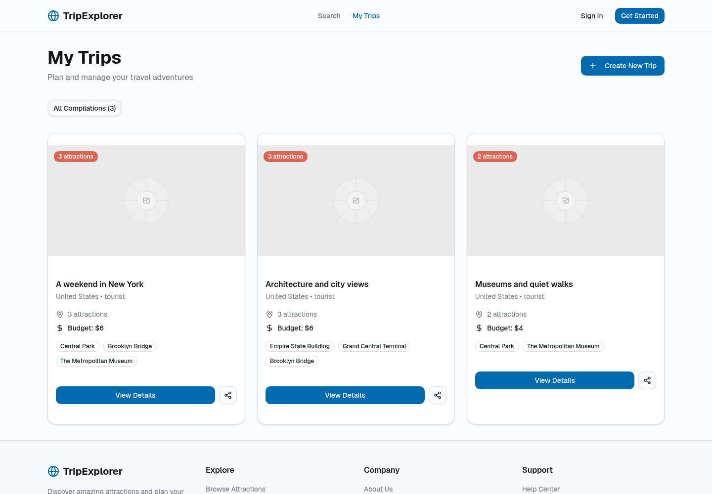
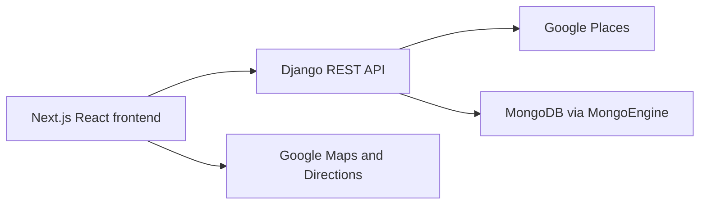

[Français](docs/CASE_STUDY.fr.md) · [Philippe Le Goff](https://github.com/PhilLeGoff) · [Portfolio](https://www.webbyphil.net/)

# TripExplorer

A travel-planning application connecting place discovery, saved trips, attraction details and route planning. The React frontend and Django API are now available together in one checkout.

**React · Next.js · TypeScript · Django REST Framework · MongoDB · Google Maps**

*Screenshot context: real application interface rendered locally with synthetic fixtures. The image does not establish live backend or production usage.*

## What it does

- Discover attractions through search and map-oriented views.
- Inspect attraction details and save places into trip compilations.
- Use Google Maps/Directions integrations for route planning.
- Connect account and trip workflows to a Django REST API backed by MongoDB.

## Architecture

## My contribution

I developed this academic full-stack application. This presentation brings its frontend and backend together as normal directories, retaining the original project history and recording the imported component revisions. It removes the need to discover and clone separate repositories before inspecting the product.

## Running and inspecting the project

Use the preserved frontend Yarn lockfile and backend Python requirements. See [setup](docs/SETUP.md). Google browser keys are intentionally client-visible and need API/domain restrictions; server keys stay on the backend. The screenshot uses a local interface fixture and does not demonstrate live Google results.

## Current state and limitations

Academic prototype. Live map/search features require configured Google API credentials and a running MongoDB-backed API. Development authentication and authorization need review before public deployment. No live service or production traffic is claimed.

## Credits

See [component provenance](docs/PROVENANCE.md). Existing third-party notices remain in their source files.
