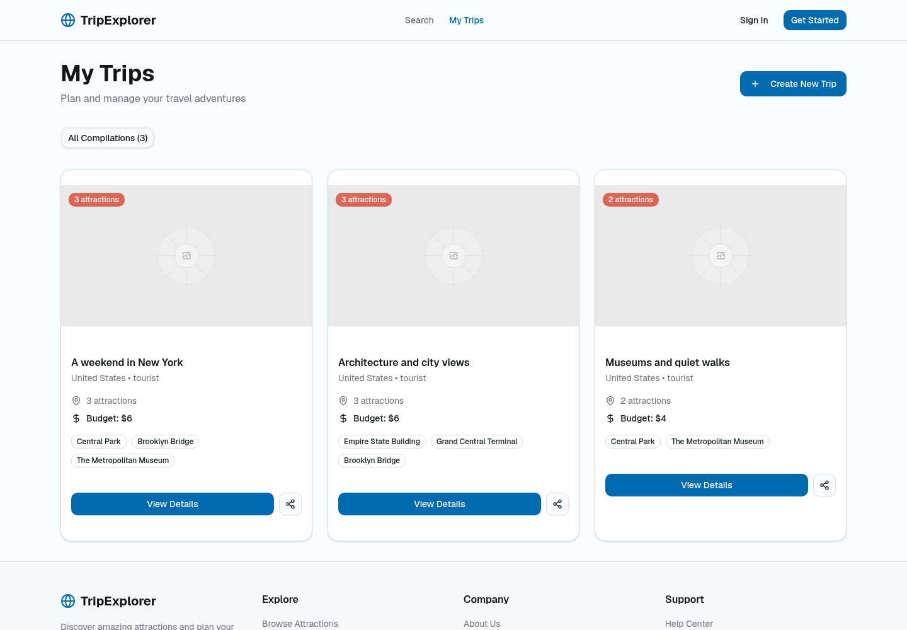
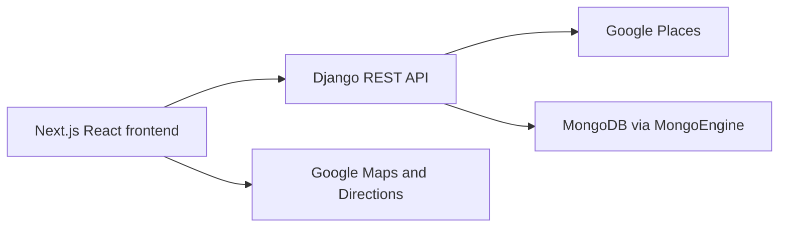

# TripExplorer

**Explorer des lieux et organiser ses découvertes en voyage.**

[English](../README.md) · [Portfolio](https://www.webbyphil.net/)

Une application de préparation de voyage : découverte de lieux, voyages sauvegardés, détails des attractions et itinéraires. Le frontend React et l’API Django sont désormais réunis dans un seul checkout.

**React · Next.js · TypeScript · Django REST Framework · MongoDB · Google Maps**

*Interface réelle exécutée localement avec des données fictives. La capture ne démontre pas un usage de production.*

## Fonctionnalités

- Découverte d’attractions par la recherche et des vues cartographiques.
- Consultation des détails et sauvegarde de lieux dans des voyages.
- Intégrations Google Maps/Directions pour préparer les itinéraires.
- Parcours de comptes et voyages reliés à une API Django REST et MongoDB.

## Architecture

## Ma contribution

J’ai développé cette application full-stack académique. Cette présentation réunit le frontend et le backend dans des dossiers ordinaires, conserve l’historique du projet et documente les révisions importées. Il n’est plus nécessaire de retrouver et cloner plusieurs dépôts pour examiner le produit.

## Installation et consultation

Utilisez le lockfile Yarn préservé et les dépendances Python du backend. Consultez l’[installation](SETUP.md). Les clés navigateur Google sont visibles côté client et nécessitent des restrictions d’API et de domaine ; les clés serveur restent côté backend. La capture utilise une fixture locale et ne représente pas une recherche Google réelle.

## État actuel et limites

Prototype académique. La carte et la recherche réelles nécessitent les clés Google configurées et une API reliée à MongoDB. L’authentification et les autorisations doivent être revues avant déploiement public. Aucun service hébergé ni trafic de production n’est revendiqué.

Les crédits et références d’origine sont conservés dans le [README principal](../README.md#credits).
